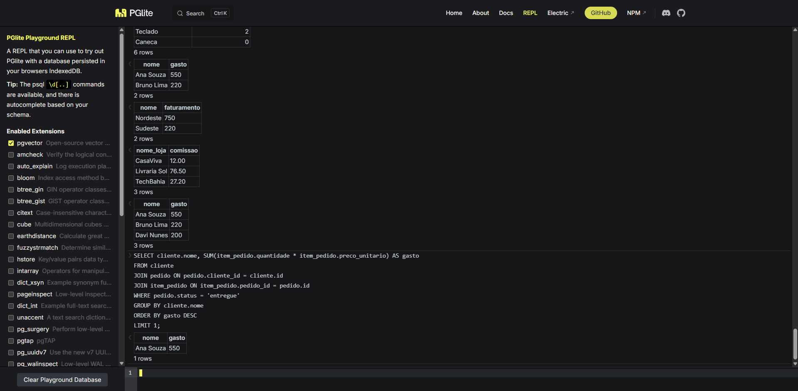

# Aula 2 - SQL na pratica e bancos nao relacionais

Exercicios da aula 2 do modulo 2 do PDA. Banco do MercadoAgil com queries SQL e um comparativo entre banco relacional, de documentos e busca semantica.

## Arquivos

- `exercicios.sql`: estrutura do banco (tabelas e dados) e as queries da aula e da lista pra casa
- `exercicio.md`: comparativo entre os tipos de banco e as respostas dos exercicios 3 e 4

## Como rodar

1. Abrir o https://pglite.dev/repl
2. Colar a parte ESTRUTURA do `exercicios.sql` e executar
3. Rodar `SELECT COUNT(*) FROM produto;` pra conferir (tem que dar 6)
4. Rodar as queries uma por vez

Se der erro de tabela que ja existe, clica em Clear Playground Database e cola a estrutura de novo.

## Resultado no PGlite

## O que usei

- PostgreSQL (PGlite)
- SELECT, WHERE, ORDER BY, LIMIT
- JOIN e LEFT JOIN
- GROUP BY, HAVING, COUNT, SUM, COALESCE
